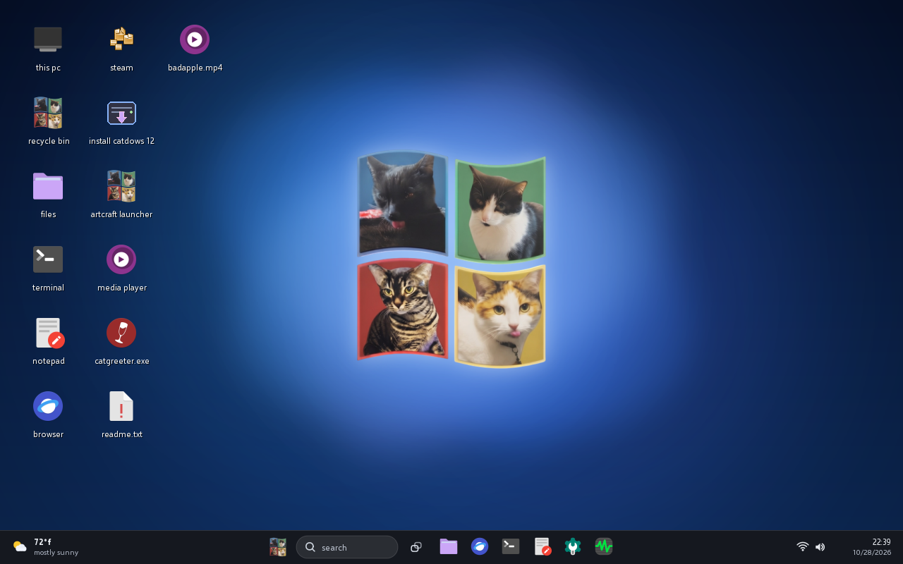
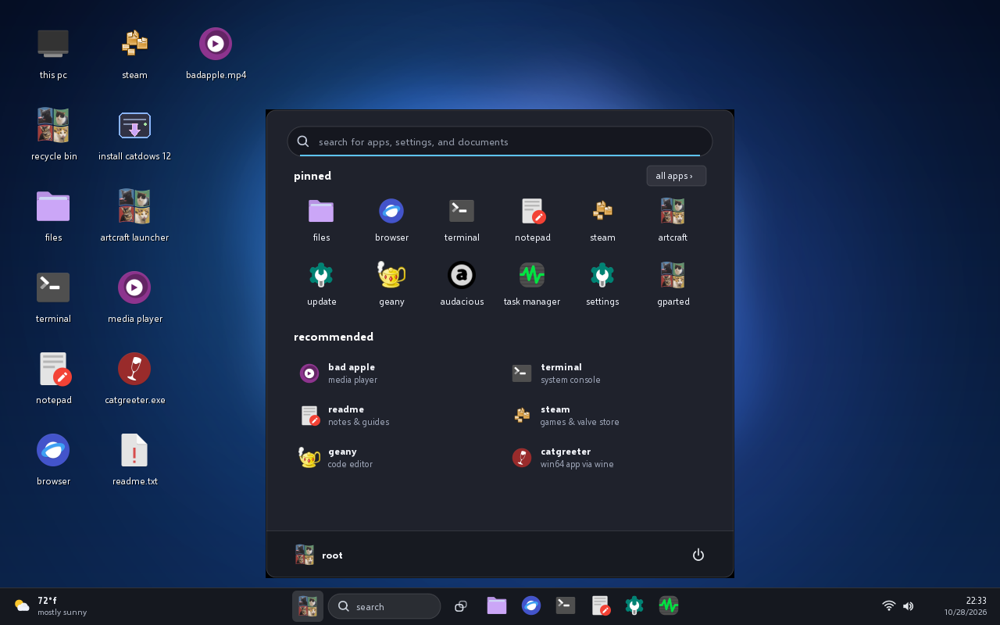
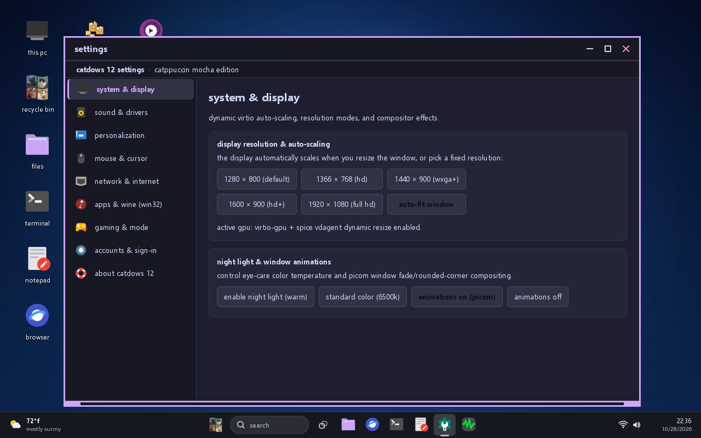
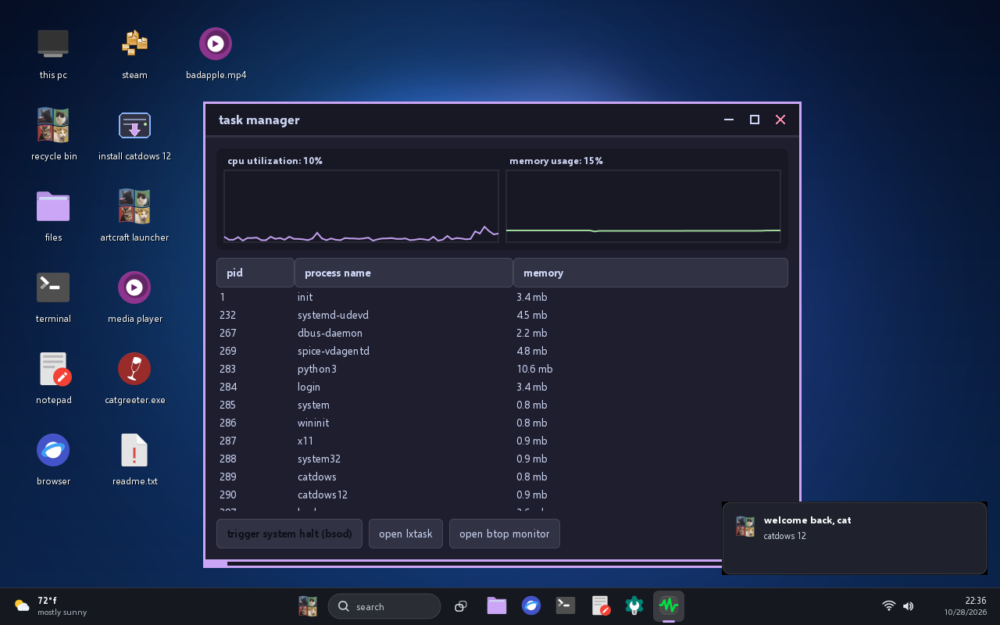
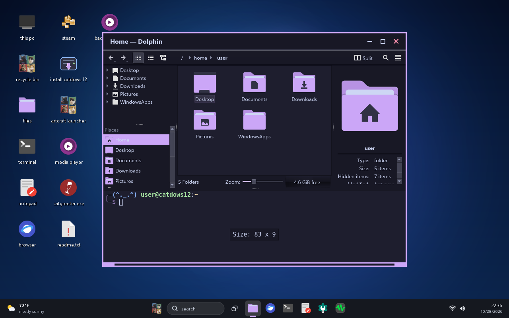
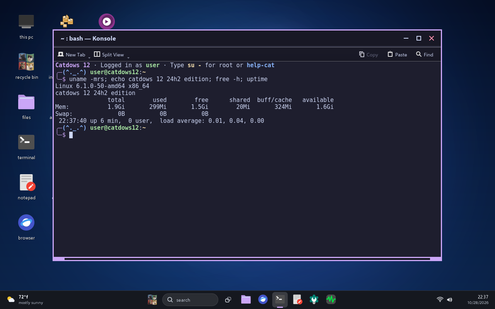
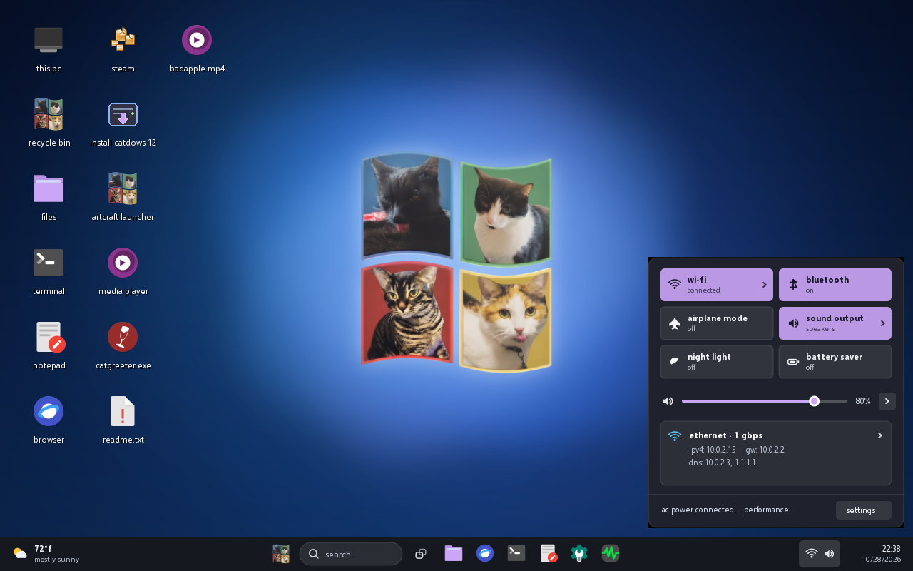
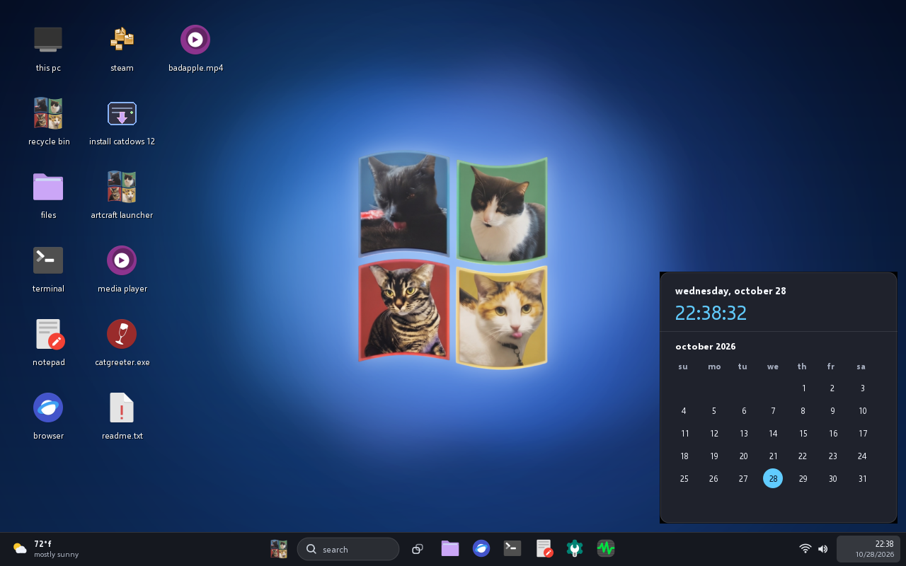
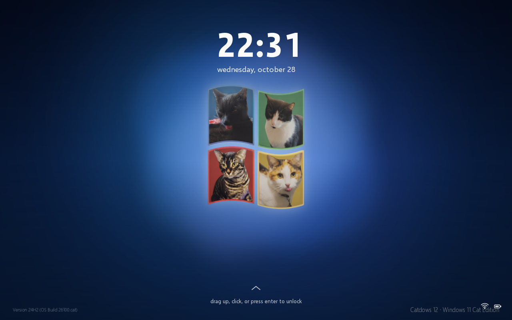
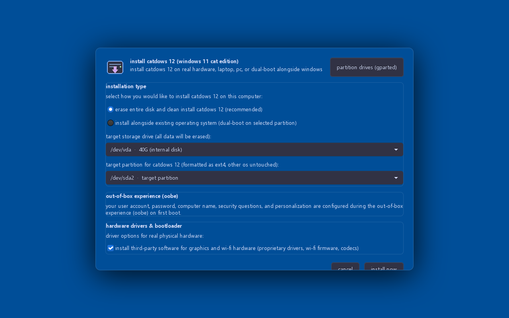

# Catdows 12 — Official ISO Releases

Catdows 12 (Windows 11 24H2 Cat Edition) is a lightweight, high-performance operating system modeled after Windows 11 24H2 with a Catppuccin Mocha visual aesthetic, built with a 100% native C11 desktop shell and system utilities.

A single universal hybrid bootable ISO (`catdows12-24h2.iso`) is provided for physical computers and virtual machines.

---

## Screenshots

| Desktop | Centered Start Menu |
|---|---|
|  |  |

| Settings | Task Manager |
|---|---|
|  |  |

| File Explorer | Terminal |
|---|---|
|  |  |

| Quick Settings | Calendar & Clock |
|---|---|
|  |  |

| Lock Screen | Live Installer |
|---|---|
|  |  |

---

## Release Images

| Release File | Format | Compatibility | Purpose |
|---|---|---|---|
| `catdows12-24h2.iso` | Hybrid Bootable ISO (UEFI + BIOS) | Real PCs & Virtual Machines | Universal installer medium for physical hardware, QEMU, Virt-Manager, VirtualBox, VMware, and Proxmox. |

---

## Installation & Deployment

### 1. Real Physical PC Hardware
Bootable on both modern 64-bit UEFI firmware (`x86_64-efi`) and Legacy BIOS (`i386-pc`):

- **Linux Command Line (`dd`)**:
  ```bash
  # Identify your USB drive (e.g. /dev/sdX)
  lsblk

  # Flash directly to USB block device
  sudo dd if=catdows12-24h2.iso of=/dev/sdX bs=4M status=progress conv=fdatasync
  sudo sync
  ```
- **Windows (Rufus)**:
  1. Download Rufus from https://rufus.ie/
  2. Select your USB drive (16 GB minimum recommended).
  3. Load `catdows12-24h2.iso`.
  4. Partition scheme: `GPT` (for UEFI) or `MBR` (for BIOS).
  5. Click Start (select Write in DD Image mode if prompted).
- **Cross-Platform (BalenaEtcher / Ventoy)**:
  - Flash `catdows12-24h2.iso` using BalenaEtcher, or copy the ISO directly into a Ventoy USB flash drive.

### 2. Virtual Machines

- **QEMU / KVM**:
  ```bash
  qemu-system-x86_64 -enable-kvm -m 4096 -smp 2 -cpu host \
      -cdrom catdows12-24h2.iso \
      -drive file=target.qcow2,format=qcow2,size=20G \
      -vga virtio -display gtk
  ```
- **Virt-Manager**: Create a new Virtual Machine, choose "Local install media (ISO image)", select `catdows12-24h2.iso`, set RAM to 4096 MB, and boot.
- **Oracle VirtualBox**: Create a new Linux 64-bit VM, attach `catdows12-24h2.iso` to the Optical Drive in Storage settings, allocate 4 GB RAM, and start.
- **VMware Workstation / Player / ESXi**: Create a new VM, specify `catdows12-24h2.iso` as the installer disc image file, and power on the virtual machine.
- **Proxmox VE**: Upload `catdows12-24h2.iso` to the `local` ISO repository, configure the CD/DVD drive of your VM to use the ISO, and launch console.

---

## Hardware Specifications

- Processor: 64-bit x86_64 dual-core or faster (Intel Core / Xeon, AMD Athlon / Ryzen)
- RAM: Minimum 1 GB with automated transparent ZRAM memory compression (2 GB - 4 GB recommended)
- Graphics: Intel HD / Iris / Xe, AMD Radeon, NVIDIA, or VM virtual GPU (Cirrus, Bochs, VirtIO, QXL, VMware SVGA) with 16 MB+ VRAM
- Firmware: UEFI (Secure Boot disabled) or Legacy BIOS
- Target Storage: 16 GB internal NVMe, SATA SSD, AHCI, IDE, or SCSI drive

---

## Live Installer Environment

Booting the ISO launches directly into the Catdows 12 Live Setup environment:
- Solid vibrant Windows Setup Blue background (`#005a9e`)
- Minimal memory footprint: runs smoothly in VMs with 1 GB RAM and 16 MB-32 MB VRAM
- Setup Wizard automatically opens front and center with high-speed parallel disk extraction
- Dual UEFI + BIOS GRUB bootloader installation with persistent UUID fstab generation

---

## In-Place GitHub System Updates

Installed systems include the native Catdows Update Wizard (`catapps update` / `cat-update`):
- Connects directly to GitHub Releases
- Retrieves and extracts updated shell binaries, hardware supervisors, and installer tools
- Preserves user configuration and home directory data

---

## Source Code Repository

The full native C11 source code, drivers, and supervisors are maintained at:
https://github.com/Nicky-LogicMeow/catdows12
